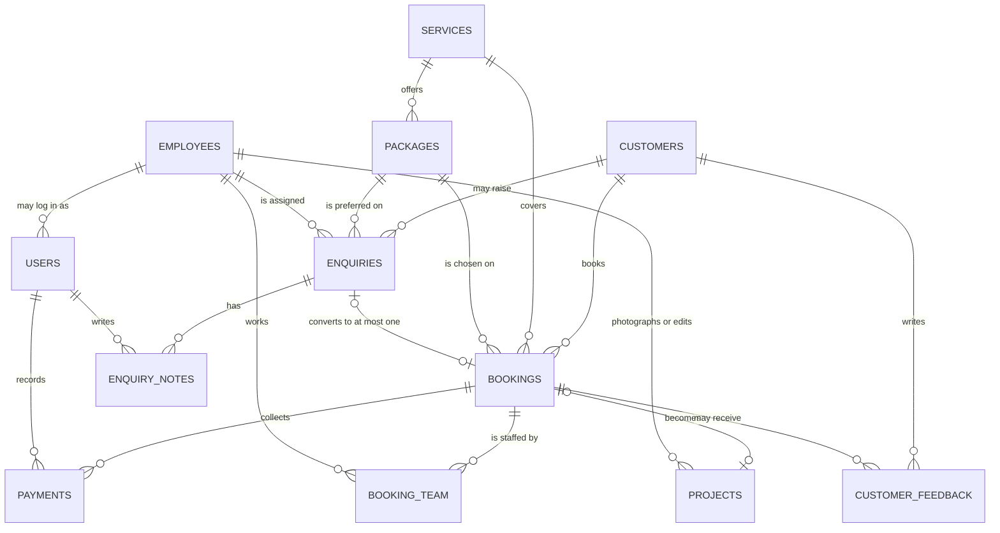

# FotoInsight architecture

FotoInsight is a photography studio website plus a private office. Visitors can read about the studio and send an enquiry. Staff sign in to record customers, bookings, payments, and projects, and to see what the numbers say.

The figures in the office are calculated from the database. They are not typed into the page. The sample rows shipped with the project are synthetic demo data. They are not a real studio's accounts.

## 1. How the pieces fit

Think of four layers.

1. **Pages.** HTML written with Jinja templates and styled with Bootstrap 5 and a small CSS file. The public site is the shop window. The admin site is the office.
2. **Flask routes.** Each area (customers, enquiries, bookings, and so on) has its own route file. A route checks who is logged in, checks the form, and asks a model to read or write MySQL.
3. **Models and analytics.** Models run the SQL for day-to-day records. The analytics package loads those rows into Pandas, then uses NumPy for rates, averages, percentiles, and growth. Routes do not contain the maths.
4. **MySQL.** One relational database. Money is stored as `DECIMAL`, not as a floating-point column.

A chart follows this path:

```text
MySQL  ->  Flask  ->  Pandas and NumPy  ->  JSON  ->  fetch()  ->  Chart.js
```

Saving a form follows this path:

```text
HTML form  ->  fetch() with a security token  ->  Flask validation  ->  MySQL
```

Passwords are stored only as Werkzeug hashes. A session cookie remembers who signed in. An administrator can open every screen. An employee can open enquiries, customers, and bookings assigned to them, and can change the status of a project where they are the photographer or the editor.

## 2. Database diagram



`business_settings` is a single row (id = 1) for the public name, phone, address, and map. It is not a child of the other tables.

## 3. How the tables relate

| From | To | Relationship | Rule |
| --- | --- | --- | --- |
| users | employees | Many logins can point at one employee; an admin login may have none | Deleting an employee keeps the login but clears the link |
| customers | enquiries | One customer, many enquiries | A customer with enquiries cannot be deleted |
| customers | bookings | One customer, many bookings | A customer with bookings cannot be deleted |
| enquiries | bookings | One enquiry becomes at most one booking | `bookings.enquiry_id` is unique, so a second conversion is rejected |
| services | packages | One service, many packages | A service used by bookings is deactivated instead of deleted |
| services | bookings | Every booking names one service | The event type stored on the booking is the service name |
| bookings | payments | One booking, many payment rows | Deleting a booking removes its payments |
| bookings | booking_team | One booking, many staff rows | The same person can hold more than one role, but not the same role twice |
| bookings | projects | One booking, at most one project | The project is removed if the booking is deleted |
| enquiries | enquiry_notes | One enquiry, many notes | Notes are removed with the enquiry |
| customers | customer_feedback | One customer, many notes | Public notes can appear on the website |

Two money rules are enforced in Python as well as explained in the office:

- **Revenue** is the sum of payments marked Paid or Partially Paid, minus payments marked Refunded. Pending payments are ignored. The booking contract is not revenue.
- **Conversion rate** = converted enquiries ÷ eligible enquiries × 100. Eligible statuses are Contacted, Follow-up Required, Negotiation, Converted, and Rejected. Status New is left out because nobody has worked that enquiry yet.

## 4. Modules

| Module | What it does |
| --- | --- |
| Public website | Home, about, services, portfolio, enquiry, contact. Services and prices are read from MySQL. |
| Auth | Login, logout, hashed passwords, admin and employee roles |
| Customers | Add, edit, delete, search, filter, booking history. Spending is summed from payments. |
| Enquiries | The public form and the office desk. Assign a person, add a note, convert once into a booking. |
| Bookings | Table and month calendar, team assignment, status, contract versus collected versus remaining |
| Services and packages | The catalogue the website shows. Activate, deactivate, or replace the photograph. |
| Payments | UPI, cash, bank transfer, card, or other. Statuses: Paid, Pending, Partially Paid, Refunded. |
| Projects | One delivery job per booking. Delayed means the delivery date has passed and the job is not finished. |
| Analytics | Revenue, customers, conversion, services, seasons, cities, written insights, and a guarded forecast |
| Reports | PDF, Excel, and CSV for revenue, bookings, customers, conversion, services, and a combined business report |
| Settings | Public contact details, employees, logins, and the signed-in user's password |

## 5. Folder structure

```text
FotoInsight/
├── app/
│   ├── __init__.py          # builds the Flask app, security checks, error pages
│   ├── config.py            # reads .env
│   ├── db.py                # MySQL connection for the current request
│   ├── authz.py             # login and admin checks
│   ├── constants.py         # status names and the two formulas
│   ├── validators.py        # server-side form checks
│   ├── routes/              # one file per area, HTML pages and JSON
│   ├── models/              # SQL for each table
│   ├── analytics/           # Pandas and NumPy, kept out of the routes
│   ├── reports/             # PDF, Excel, CSV
│   ├── templates/public/    # website
│   ├── templates/admin/     # office
│   ├── templates/auth/      # login
│   └── static/              # CSS, JavaScript, photographs, Bootstrap, Chart.js
├── database/
│   ├── schema.sql
│   └── seed_data.py
├── docs/ARCHITECTURE.md
├── tests/
├── requirements.txt
├── run.py
├── .env.example
└── README.md
```

## 6. Development roadmap

The work was done in the order below. Later phases use the tables and pages from the earlier ones.

1. **Plan.** Tables, roles, and the rule that revenue means cash collected.
2. **Public pages.** Navigation, services, gallery, enquiry form, contact.
3. **Office shell.** Login, sidebar, and protected pages.
4. **Records.** Customers, enquiries, bookings, services, payments, projects, all stored in MySQL.
5. **Analytics.** The same records, grouped with Pandas and scored with NumPy, drawn with Chart.js.
6. **Reports.** Download those calculations as PDF, Excel, or CSV.
7. **Checks.** Automated tests for login, duplicates, money, permissions, empty ranges, and file downloads. A demo seed of 220 customers, 340 enquiries, 170 bookings, 259 payments, and 80 projects.

## 7. What to install

- Python 3.12 (3.10 or newer is enough)
- MySQL 8
- A virtual environment and the packages in `requirements.txt`

You do not need Node.js, React, or MongoDB. Bootstrap 5 and Chart.js are already saved in `app/static/vendor`, so the office works without a CDN.

Step-by-step setup is in the README.
